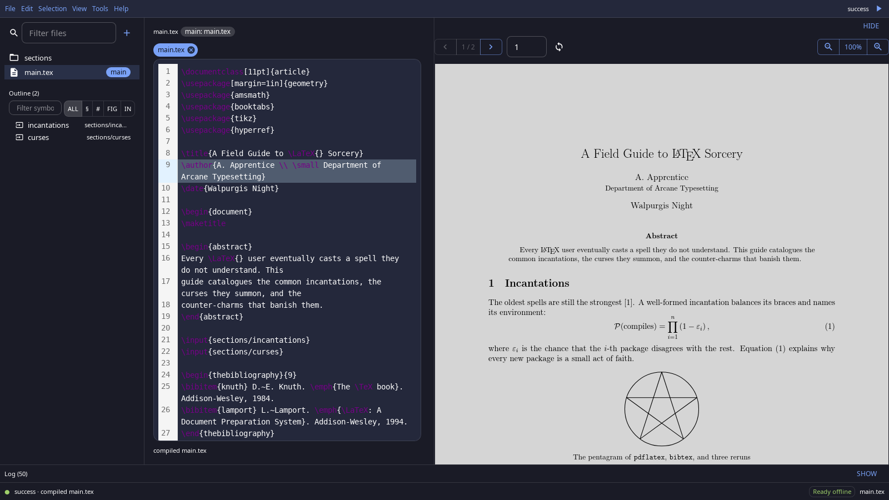
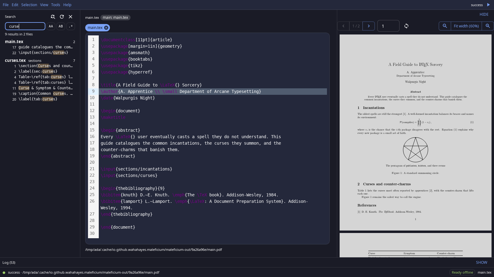
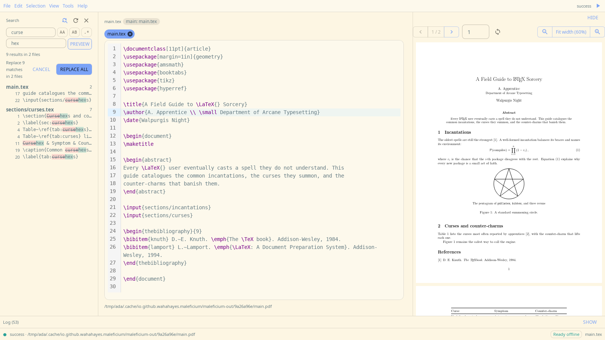

# Maleficium

> **maleficium** _(n.)_: an act of evil sorcery. Also known as debugging LaTeX. This makes the ritual easier.

[](https://m8ven.ai/mcp/wahahayes-maleficium-11vtyi?s=readme) [](LICENSE)

A fully local LaTeX editor, built in Rust and Tauri. It has an MCP server so AI agents can work alongside you, and it turns the same source into both the PDF and an interactive web paper.



## Why Maleficium

- **Local and private.** No account, no cloud, no telemetry. Your projects stay in your folders ([privacy](PRIVACY.md)).
- **Nothing else to install.** The TeX engine is bundled. After the first compile it works offline.
- **Made to be changed.** Open source. Templates are folders, themes are VS Code theme files.

## Features

- **One-key compile** (Ctrl+R), with a pre-check for missing packages, fonts, and tools.
- **SyncTeX both ways:** double-click source to find it in the PDF, click the PDF to jump back.
- **Navigation:** file tree, outline, go to definition, quick file finder (Ctrl+P).
- **Project-wide search and replace**, previewed first and undone in one step.
- **Revision history** on every save (Ctrl+H).
- **Templates and themes**, dark and light.
- **Interactive papers:** the same source also exports a web page with live figures ([below](#interactive-papers)).
- **MCP server** for AI agents: compile, search, replace, and jump through SyncTeX with the same core as the editor ([setup](#use-with-an-ai-agent)).

<p>
  
  
</p>

## Install

Download from the [latest release](https://github.com/wahahayes/maleficium/releases/latest).

**Linux (x86_64).** On Debian or Ubuntu:

```sh
sudo apt install ./Maleficium_*_amd64.deb
```

Anywhere else, use the AppImage (`chmod +x` it, then run it). If it fails with a FUSE error, set `APPIMAGE_EXTRACT_AND_RUN=1`.

**macOS (preview).** Open the `.dmg` for your Mac (`aarch64` for Apple silicon, `x64` for Intel) and drag Maleficium to Applications. The app is unsigned: on first launch, allow it in **System Settings > Privacy & Security**. If macOS calls it damaged, run:

```sh
xattr -dr com.apple.quarantine /Applications/Maleficium.app
```

**Windows (preview).** Run `Maleficium_*_x64-setup.exe`. The installer is unsigned: in the SmartScreen warning, click **More info**, then **Run anyway**.

**From source:** see [docs/BUILDING.md](docs/BUILDING.md).

## Getting started

1. **File > Open Project** (Ctrl+O) opens a folder of `.tex` files. **File > New Project from Template** starts one.
2. **Ctrl+R** compiles. The main file is found for you; right-click a file and pick **Set as Main File** to change it.
3. **Help > Keyboard Shortcuts** lists every shortcut.

## Interactive papers

Your paper still compiles to a normal PDF, and Maleficium can also export it as a web page where readers can rotate 3D models, explore charts, sort tables, and play video. The [eye-gaze example](examples/eye-gaze-interactive/) is a published paper made this way.

1. Projects made from a template already include `maleficium-interactive.sty`.
2. Use its macros (`\interactivemodel`, `\interactivechart`, `\interactivetable`, `\interactivevideo`, `\interactive`). The PDF shows a poster for each.
3. **File > Preview in Browser**, or **File > Export Paper Bundle**.

Posters, widget approval, styling, and limits: [docs/INTERACTIVE-PAPERS.md](docs/INTERACTIVE-PAPERS.md).

## Use with an AI agent

Keep the app open and its preview reloads each time the agent compiles. To add the server to Claude Code with the `.deb` install:

```sh
claude mcp add maleficium -- /usr/bin/maleficium --mcp
```

Other installs and clients: [docs/MCP.md](docs/MCP.md).

[](https://www.youtube.com/watch?v=Ke4eT5Lx37Q)

## Known limits

- macOS and Windows builds are unsigned previews, less tested than Linux.
- No automatic updates. Check the releases page.
- Until 1.0, settings and history may not carry over between versions.
- The engine is Tectonic only. Documents that need `biber` or shell escape rely on tools outside the app; the pre-check flags them.

## Documentation

- [Building from source](docs/BUILDING.md) and releases
- [Contributing](docs/CONTRIBUTING.md)
- [Interactive papers](docs/INTERACTIVE-PAPERS.md), [video embeds](docs/VIDEO-EMBEDS.md), and [custom widget runtimes](docs/RUNTIMES.md)
- [MCP server setup](docs/MCP.md)
- [Built-in templates](src-tauri/templates/README.md)
- [Test harnesses](e2e/README.md)
- [Privacy](PRIVACY.md) and [changelog](CHANGELOG.md)

## License

Copyright (C) 2026 Ethan Wilson. Maleficium is [AGPL-3.0](LICENSE).

What it puts in your work carries no obligations: the built-in templates are CC0, and the code inside exported papers is MIT-0 ([embed-runtime/](embed-runtime/README.md)). Third-party credits are in [NOTICE](NOTICE).
